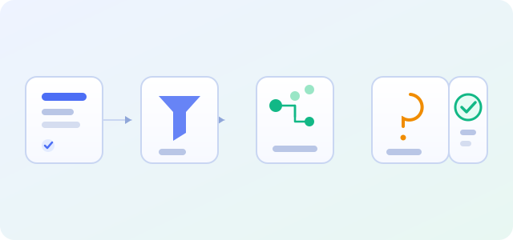

# The work protocol in detail

## Why a protocol at all

A coding agent's behaviour is mostly decided by what its system prompt says before
the first user turn. Profiles accumulate skills, tools and MCP servers, but rarely a
*consistent* answer to four questions:

1. What should the user see first?
2. When is a request clear enough to execute?
3. When must the agent stop and ask?
4. What must be true before the agent says "done"?

`dsh-agent-protocol` answers those four questions once, in one system-prompt section,
so every agent in the profile behaves the same way on the first turn — not after the
user has corrected it three times.

The protocol's first sentence sets the priority: when it conflicts with an explicit
instruction from the user, the user wins.

## Section by section

Sections are numbered consecutively at build time; they are described here in order
of appearance.

### Visibility

The first reply to a **new task** opens with a task line: `[Task] <one line>`
(Chinese: `【任务】...`). Follow-ups, later replies on the same task, greetings and
short answers do not — the task line is a signpost for a task, not a header for every
reply. A loaded skill gets its own `[Skill] <name>` line in the reply that loads it.

When the agent proceeds on an unconfirmed premise it adds an explicit `[Assumption]`
line instead of hiding the guess. This rule has no switch: several exits of "ask
before acting" land on `[Assumption]`, so it must always be defined.

### Refine once

Colloquial input ("make the docs better", "fix that thing") is compressed into a
single statement containing action, object, constraints and the capability being
used. That statement *is* the execution instruction. Writing a second, expanded
version is explicitly ruled out — it is the most common way agents burn a turn.

A structured brief (goal / inputs / constraints / steps / acceptance / rollback) is
only added when material ambiguity survives the compression.

### Strict mode

Triggers on any of: ≥3 explicit constraints; ≥2 subsystems or a wide change (about ≥5
files); irreversible or high-risk work; an estimated >10 minutes or several rounds; or
the user explicitly asking for rigour.

When triggered:

- a **constraint list** with a *decidable* acceptance criterion per item, before starting;
- gaps are confirmed first;
- an **item-by-item** check at delivery — each item marked met/not met with evidence.

When not triggered, the agent is told **not** to output a constraint list, so ordinary
tasks do not get wrapped in tables. `preset: strict` replaces the triggers with "every
non-trivial task".

Strict mode governs output shape. Asking is governed by "ask before acting" and only
happens when a real gap exists.

### Capability routing

Skills and tools are matched **semantically, by capability**, not by literal keyword,
and loaded before the agent acts. Chaining is allowed and encouraged. Before replying,
the agent checks whether it silently skipped an available capability, and when a
dependency is missing it must say so and offer a fallback rather than quietly bypass it.

### Ask before acting

The goal of this section is **few, precise questions**. Only five situations force one:

1. the deliverable has two or more reasonable interpretations and the wrong one means rework;
2. a key value, range or definition is missing;
3. the reference or request is vague and context, files and history cannot resolve it;
4. irreversible work with an unclear target or blast radius;
5. the user explicitly asks to confirm first.

With `researchClarify` on (the default) there is a sixth: research work (literature,
simulation, experiment design, analysis, paper/proposal, group-meeting or defence
material) confirms scope, definitions and output format before starting — without
re-asking anything the user already specified.

How to ask: everything at once, at most three questions, each with options and a marked
recommendation; through the host's question tool (e.g. `ask_user_question`) when there
is one, so the user just clicks.

**Three things must not be asked** — this is what keeps the protocol out of the way:

- anything decidable by reading files, searching, or inspecting the environment — a
  config value that is in `package.json` is not a question, it is a read;
- anything reversible and cheap to get wrong — take the most reasonable reading and
  add an `[Assumption]` line;
- anything after the user said "just do it" or "you decide".

After the user answers, the agent executes directly and never repeats a question.

**When nobody can be asked.** DSH keeps the system prompt uniform across parents and
children, so subagents, background jobs and scheduled runs receive this protocol too —
with no user in front of them. In that case the agent must neither ask nor stop: it
takes the most reasonable reading and lists its `[Assumption]`s in the result for the
parent to judge.

### Team

Teams are expensive and only worth it for ≥4 steps with independent parallel subtasks,
a research→implement→verify split, long runtimes, or an explicit request. Member briefs
carry task, skills, acceptance criteria and artifact paths. The team field is not
reported to the user — the UI shows it.

### Efficiency and safety

Always on, no switch: parallelize independent subtasks; back up or state impact before
modifying or deleting; explain consequences before irreversible actions; search large
files before reading them in chunks; reply in the user's language, conclusion first, a
table when comparing or enumerating, no irrelevant log dumps.

### Delivery self-check

Six silent questions before "done": declared skills == loaded skills? acceptance met?
artifact paths given? rollback stated for overwrite/delete? did you ask what should
have been asked? are the conclusions verified rather than assumed?

The check is **not printed** unless strict mode is active. Questions that refer to a
disabled section are dropped from the list.

### Additional rules

Each item of `extraRules` is appended as one rule in a final section — a place for
deployment-specific clauses without forking the plugin.

## Settings page

The **Work protocol** sidebar entry opens the settings page: preset, switches, the
wording of each section and the additional rules on the left; the exact injected text
with character and estimated token counts on the right, updated live. Every section
body can be rewritten; a rewritten section is marked "Edited", can be restored with
one click, and no longer changes wording with the switches. Saving applies to every
session from its next model request, without a restart. Page edits layer on top of the
row config in Settings → Plugins and are stored in
`$DSH_HOME/agent-protocol/overrides.json`.

## Choosing a preset

| Preset | For | Behaviour |
|---|---|---|
| `lite` | The protocol feels heavy; mostly conversation and small edits | No task line, no constraint list, no self-check; refinement, routing and clarification only |
| `standard` | Default | One task line per new task; strict mode only for complex work |
| `strict` | Releases, migrations, research deliverables — work that must not go wrong | Every non-trivial task gets a constraint list and an item-by-item check |

A preset only sets switch defaults; an explicit switch always wins.

## Worked example

Request: *"Update both locale files, add the missing config to the README, bump the
version, then publish."*

- **Strict mode?** 4 requirements (≥3) and `publish` is irreversible → two triggers.
- **Clarify?** Yes, one question: *"patch or minor? Adding a documented config key is a
  feature → I recommend a minor bump."* (A missing key value that changes the artifact.)
- **Constraint list** — locale files valid JSON / README lists all keys / version
  distinct from npm latest / tarball contains `lib`, `docs`, `icon.svg`.
- **Delivery** — four items marked met with evidence (file line, command output),
  plus the rollback note (published versions cannot be unpublished after 72 h;
  the local backup path is recorded).

If nothing had been missing, the same task would produce the list, execute, and
deliver with **zero questions**.

Conversely, *"give this function a clearer name"* is reversible and cheap → no
question; the agent renames it and adds "[Assumption] named after what callers use it for".

## FAQ

**Is it a hard gate?** No. It is system-prompt text. A model can still deviate; the
plugin never blocks a tool call or validates output.

**Does it slow every turn down?** No. The task line appears only on the first reply to
a new task, only strict-mode tasks pay for the list, and the self-check is silent.

**Still too many questions?** Turn `researchClarify` off, or use `preset: lite`. Saying
"just do it" in the conversation also stops further questions.

**Can I disable one section?** Yes — eight switches and three presets, on the Work
protocol page in the sidebar; saving applies immediately. Efficiency & safety and the `[Assumption]`
line have no switch.

**Does it work in English?** Yes: `language: en` swaps the whole protocol text. The
reply language always follows the user regardless of this setting.

**Does it write anything to my profile?** No. Installing adds one host row. Saving on
the settings page writes one file, `$DSH_HOME/agent-protocol/overrides.json`, which
you can delete by hand after uninstalling.

## Compatibility

`engines.dsh`: `>=0.2.2-rc.1 <0.3.0-0`. No network access, no telemetry, no data collection.
